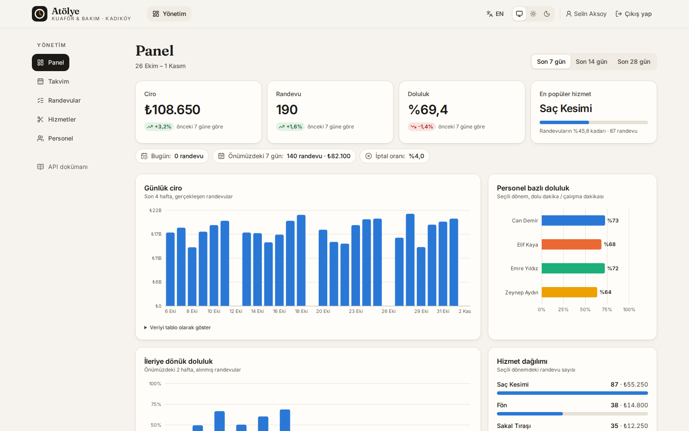
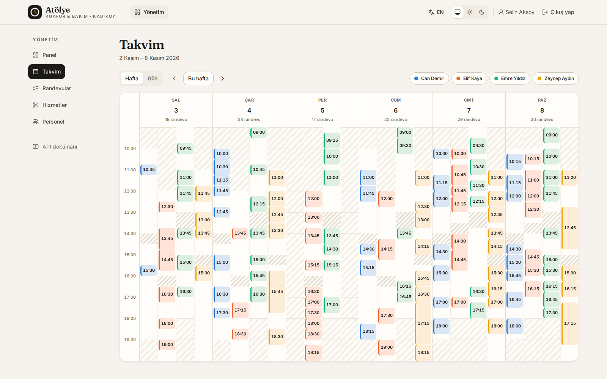
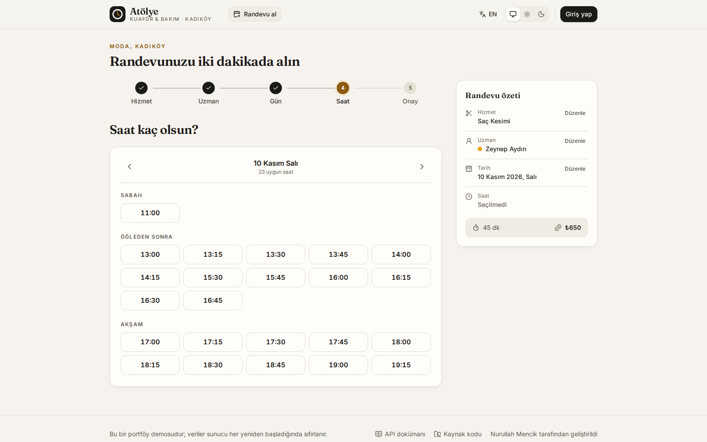
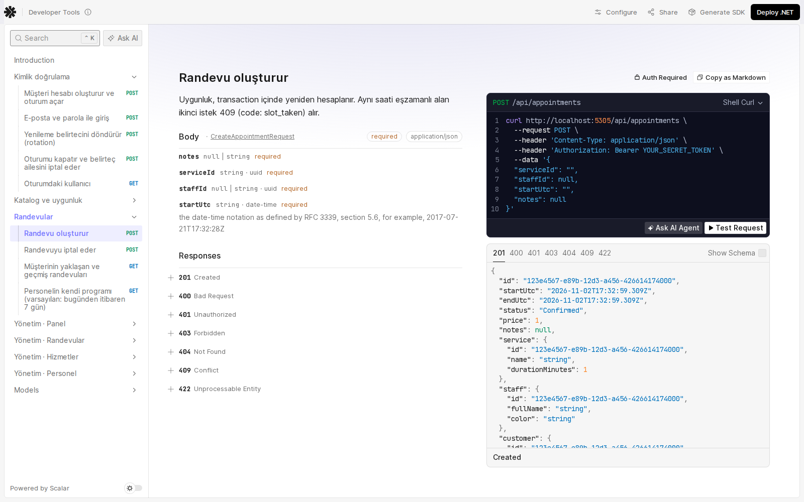
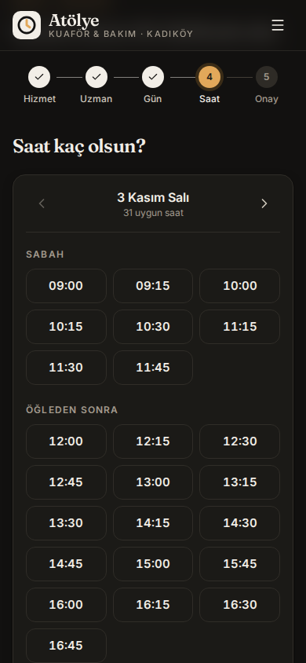
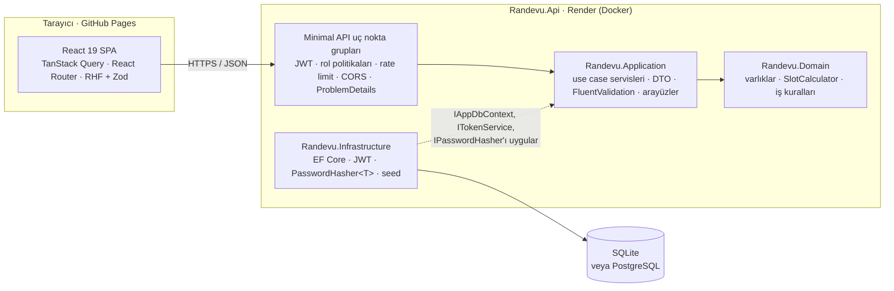
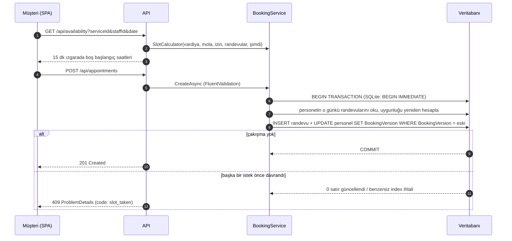

# Randevu — çok personelli işletmeler için online randevu sistemi

[](https://github.com/nurullahmencik/randevu-sistemi/actions/workflows/ci.yml)


**Kuaför, güzellik merkezi, klinik gibi birden fazla personeli olan işletmelerin; hizmet, uzman, gün ve saat seçerek çakışmasız randevu aldığı, yönetimin ise doluluğu ve ciroyu tek panelden izlediği ASP.NET Core 10 + React uygulaması.**

Örnek işletme: **Atölye Kuaför & Bakım — Kadıköy** (6 hizmet, 4 personel, son 4 hafta + önümüzdeki 2 haftaya yayılmış ~1.000 gerçekçi randevu).



## Canlı demo

| | Adres |
|---|---|
| Web uygulaması | https://nurullahmencik.github.io/randevu-sistemi/ |
| API dokümanı (Scalar) | https://randevu-api.onrender.com/scalar |
| OpenAPI belgesi | https://randevu-api.onrender.com/openapi/v1.json |

> API, Render'ın ücretsiz katmanında çalışır ve bir süre istek gelmezse uyur. İlk açılışta web uygulaması `/health` uç noktasını yoklar; yanıt gecikirse **“Sunucu uyanıyor…”** ekranı ilerleme çubuğu ve otomatik yeniden deneme ile gösterilir (genellikle 30–60 sn).

**Demo hesaplar** (giriş ekranında tek tıkla da girilebilir) — parola hepsi için `Demo123!`

| Rol | E-posta | Görebilecekleri |
|---|---|---|
| Müşteri | `musteri@randevu.demo` | Randevu alma, Randevularım, iptal |
| Personel | `personel@randevu.demo` | Bugünkü ve haftalık program (Emre Yıldız) |
| Yönetici | `admin@randevu.demo` | Panel, takvim, randevu listesi, hizmet/personel tanımları |

## Özellikler

**Müşteri**
- Adım göstergeli, mobil öncelikli 5 adımlı akış: hizmet → uzman (“fark etmez” dahil) → gün → saat → onay. Durum URL'de tutulur; yenileme, geri/ileri ve paylaşılan bağlantılar çalışır.
- Gün seçicide her gün için boş saat sayısı; kapalı ve dolu günler devre dışı.
- Saatler sabah / öğleden sonra / akşam olarak gruplanır. Seçilen saat o arada başkası tarafından alınırsa 409 yanıtı kullanıcıya açıklanır ve liste yenilenir.
- Onay adımında oturum yoksa seçim kaybolmadan tek tıkla demo müşteri girişi; başarı ekranında `.ics` takvim dosyası.
- “Randevularım”: yaklaşan/geçmiş randevular, 2 saat kuralına uyan iptal ve son iptal zamanı.

**Yönetim**
- KPI'lar: ciro, randevu sayısı, doluluk oranı (önceki eşit döneme göre değişimle), en popüler hizmet, iptal oranı, önümüzdeki 7 günün yükü.
- Grafikler (Recharts, yalnızca panel açıldığında yüklenir): günlük ciro, ileriye dönük doluluk, personel bazlı doluluk, hizmet dağılımı; her grafiğin tablo görünümü var.
- Haftalık takvim (her personel kendi renginde sabit bir şeritte) ve personel sütunlu günlük görünüm; vardiya dışı, mola ve izinler taralı gösterilir.
- Filtreli, sayfalı randevu listesi (tarih, personel, hizmet, durum, müşteri araması); iptal, “tamamlandı”, “gelmedi”.
- Hizmet ve personel CRUD: süre/fiyat, verilen hizmetler, gün bazlı vardiya ve mola, izin günleri, takvim rengi.

**Personel** — bugünkü randevular (müşteri telefonu ve notuyla) ve haftalık program.

**Genel** — Türkçe (varsayılan) / İngilizce arayüz, sistem tercihini izleyen ve elle değiştirilebilen açık/koyu tema, klavye ile tam kullanım ve görünür odak halkaları, 375 px'te yatay kaydırma yok.

## Ekran görüntüleri

| Haftalık takvim | Müşteri: saat seçimi |
|---|---|
|  |  |

| API dokümanı (Scalar) | Mobil, koyu tema |
|---|---|
|  |  |

Ekran görüntüleri üretim derlemesinden Playwright ile alınır: `cd web && npm run screenshots`.

## Mimari



Bağımlılıklar içe doğrudur: `Domain` hiçbir şeye bağlı değildir; `Application` yalnızca `Domain`'i ve kendi tanımladığı arayüzleri bilir; EF Core, JWT ve parola karması `Infrastructure`'dadır; `Api` yalnızca HTTP'yi (yönlendirme, kimlik doğrulama, hata eşleme) üstlenir.

**Randevu alma isteğinin akışı**



## Teknik kararlar

### Uygun saat algoritması
`Randevu.Domain/Scheduling/SlotCalculator.cs` saf bir fonksiyondur; veritabanı, saat ya da DI bilmez:

1. Aday başlangıçlar personelin vardiya başlangıcından itibaren **yerel saatte** 15 dakikalık ızgarada üretilir (09:00, 09:15, …) ve işletme saat dilimiyle UTC'ye çevrilir. Yerel saatte ilerlemek, yaz saati uygulayan bölgelerde de ızgaranın kaymamasını sağlar; atlanan duvar saatleri (DST boşluğu) atlanır.
2. Hizmetin tamamı vardiyaya sığmalı; molaya ve mevcut randevulara yarı açık aralık kuralıyla (`[başlangıç, bitiş)`) çakışmamalı. Böylece 12:30–13:00 bir hizmet 13:00'te başlayan molaya “dokunabilir”.
3. Şu andan (ve yapılandırılabilir minimum bildirim süresinden) önce başlayan saatler elenir.
4. Vardiya, işletme saatleriyle (Salı–Pazar 09:00–20:00) kırpılır; haftalık izin günü (vardiyası tanımlı olmayan gün) ve tarih bazlı izinler boş liste döndürür.

İstanbul 2016'dan beri yıl boyu UTC+3'tür; birim testleri bunu Avrupa'nın saat değiştirdiği günlerde de doğrular. Saat dilimi verisi olmayan ince imajlarda `Europe/Istanbul` sabit +03:00'e düşer. Veritabanında her zaman UTC tutulur; web arayüzü saatleri ziyaretçinin değil işletmenin saat diliminde gösterir.

“Fark etmez” seçildiğinde API, o saatte müsait olanlar arasından **günü en az dolu** personeli atar; iş yükü kendiliğinden dengelenir.

### Çakışma önleme: neden güvenli?
Aynı personele aynı anda iki randevu yazılmasını üç katman engeller:

1. **Transaction içinde yeniden kontrol.** Uygunluk, ekrandaki listeye güvenilmeden transaction açıldıktan sonra yeniden hesaplanır. Saat ızgara dışı/geçmişse 422 (`slot_invalid`), dolmuşsa 409 (`slot_taken`).
2. **Personel başına iyimser kilit.** `StaffMember.BookingVersion` bir *concurrency token*'dır ve her rezervasyonda değişir. EF Core güncellemeyi `UPDATE … WHERE Id = @id AND BookingVersion = @eski` olarak gönderir. Aynı personel için yarışan iki transaction'dan yalnızca biri satırı günceller; diğeri 0 satır etkiler, `DbUpdateConcurrencyException` alır ve 409'a çevrilir. Bu, **farklı başlangıç saatleriyle örtüşen** istekleri de (10:00 ve 10:15 gibi) yakalar. PostgreSQL'in varsayılan *Read Committed* yalıtımında bile çalışır, çünkü ikinci `UPDATE` ilk transaction'ın commit'ini bekler ve WHERE koşulunu yeni satır sürümüne göre tekrar değerlendirir. SQLite'ta `BEGIN IMMEDIATE` yazma transaction'larını zaten sıraya koyar.
3. **Veritabanı seviyesinde son savunma.** `(StaffMemberId, StartUtc)` üzerinde, iptal edilmemiş satırlar için filtreli **benzersiz index** (`UX_Appointments_Staff_Start_Active`). Uygulama kodu atlansa bile aynı başlangıç iki kez yazılamaz; iptal edilen saat yeniden alınabilir.

Randevunun durumunu değiştiren işlemler (iptal, tamamlandı, gelmedi) de `Appointment.Version` token'ı ile korunur. Doğrulama:
- Entegrasyon testi 6 farklı müşteriden aynı slota **eşzamanlı** istek atar: tam olarak 1 × `201`, 5 × `409`, veritabanında 1 satır.
- Docker'da PostgreSQL 17 ile elle denendi: aynı slota 8 paralel istek → 1 × 201 + 7 × 409; 15 dk kaydırılmış örtüşen saatlere 8 paralel istek → yine 1 × 201 + 7 × 409.

### Kimlik doğrulama ve refresh token rotasyonu
- **Erişim belirteci:** HS256 JWT, 15 dakika; `sub`, `role`, `staff_id` claim'leri. Roller: `Admin` (her şey), `Staff` (yalnızca kendi takvimi), `Customer` (yalnızca kendi randevuları). Başkasının randevusunu iptal etmeye çalışan müşteri, kaydın varlığını öğrenmemesi için 404 alır.
- **Yenileme belirteci:** 512 bit rastgele değer; veritabanında yalnızca **SHA-256 özeti** saklanır. Her `/api/auth/refresh` çağrısı gönderilen belirteci iptal edip aynı *aileden* yenisini verir.
- **Yeniden kullanım tespiti:** Daha önce döndürülmüş bir belirteç tekrar gelirse çalındığı varsayılır ve ailenin tamamı iptal edilir (saldırgan da gerçek kullanıcı da yeniden girişe yönlendirilir). Aynı belirteçle eşzamanlı iki yenilemeden yalnızca biri başarılı olur (`RevokedAtUtc` concurrency token).
- Parolalar ASP.NET Core Identity'nin `PasswordHasher<T>`'ı (PBKDF2) ile, Identity altyapısının tamamı olmadan karmalanır.
- Web tarafında erişim belirteci yalnızca bellekte, yenileme belirteci `localStorage`'da tutulur (API ile Pages farklı sitelerde olduğundan üçüncü taraf çerezi gerektirmeyen yol). 401 alan istek tek seferlik ve paylaşılan bir yenileme ile tekrarlanır; sekmeler arası yarışı Web Locks API engeller.

### Diğer
- **Hatalar:** Tüm hatalar RFC 9457 `ProblemDetails`; her yanıtta kararlı bir `code` (`slot_taken`, `cancellation_window_closed`, `rate_limited` …) ve `traceId` bulunur. Web arayüzü `code`'u kendi TR/EN sözlüğüyle çevirir.
- **Rate limiting:** `/api/auth/*` için IP başına sabit pencere (varsayılan 20 istek/dk), `429` + `Retry-After`.
- **Loglama:** Production'da satır başına bir JSON nesnesi (scope ve trace id'li); her istek için yöntem, rota şablonu, durum ve süre; rezervasyon çakışmaları ve token yeniden kullanımı ayrıca loglanır.
- **Veritabanı:** EF Core; SQLite (varsayılan) ve PostgreSQL için ayrı `DbContext` alt sınıfları ve ayrı migration geçmişleri repoda. Açılışta migration uygulanır, veritabanı boşsa demo veri seed edilir.
- **Ön yüz performansı:** Yönetim sayfaları, formlar (Zod) ve Recharts ayrı parçalara bölünür; ilk sayfa yalnızca müşteri akışını yükler. Derin bağlantılarda (ör. `/login`) rota parçaları küçük bir satır içi betikle `modulepreload` edilir. Türkçenin latin-ext'ten ihtiyaç duyduğu altı glif (Ğ ğ İ Ş ş ₺) için ~120 kB yerine birkaç kB'lık font alt kümeleri kullanılır (`web/scripts/subset-fonts.py`).

## Klasör yapısı

```text
randevu-sistemi/
├── api/
│   ├── Randevu.slnx · Directory.Build.props · Directory.Packages.props · global.json
│   ├── Dockerfile · .dockerignore · dotnet-tools.json (dotnet-ef)
│   ├── src/
│   │   ├── Randevu.Domain/          # Varlıklar, SlotCalculator, iş kuralları
│   │   ├── Randevu.Application/     # Features/{Auth,Catalog,Availability,Appointments,Admin,Dashboard}
│   │   ├── Randevu.Infrastructure/  # Persistence (DbContext, migrations, seed), Identity (JWT, hasher)
│   │   └── Randevu.Api/             # Program.cs, Endpoints/, Infrastructure/ (hata, log, OpenAPI)
│   └── tests/
│       ├── Randevu.UnitTests/        # Slot algoritması, domain kuralları, doğrulayıcılar
│       └── Randevu.IntegrationTests/ # WebApplicationFactory + SQLite in-memory
├── web/
│   ├── src/
│   │   ├── app/          # router, sağlayıcılar, yetki korumaları
│   │   ├── components/   # UI bileşenleri, TimeGrid takvimi, sunucu uyandırma ekranı
│   │   ├── features/     # booking, appointments, auth, admin, staff
│   │   └── lib/          # API istemcisi, i18n, tema, saf yardımcılar (+ Vitest)
│   ├── e2e/              # Playwright senaryoları
│   └── scripts/          # README ekran görüntüleri
├── docs/screenshots/
├── .github/workflows/    # ci.yml, deploy.yml
└── render.yaml           # Render Blueprint
```

## Yerel çalıştırma

**Gereksinimler:** .NET 10 SDK, Node.js 22+. SDK yoksa yönetici yetkisi olmadan kurulabilir:

```bash
curl -sSL https://dot.net/v1/dotnet-install.sh -o dotnet-install.sh
bash dotnet-install.sh --channel 10.0 --install-dir ~/.dotnet
export DOTNET_ROOT=$HOME/.dotnet PATH=$HOME/.dotnet:$PATH
```

**API** — http://localhost:5305 (Scalar: http://localhost:5305/scalar)

```bash
cd api
dotnet run --project src/Randevu.Api
```

İlk açılışta `src/Randevu.Api/App_Data/randevu.db` oluşturulur ve demo veriyle doldurulur. Sıfırdan başlamak için bu dosyayı silin. Geliştirme ortamında JWT anahtarı `appsettings.Development.json`'dan gelir; diğer ortamlarda `Jwt__Key` (en az 32 bayt) zorunludur.

**Web** — http://localhost:5304/randevu-sistemi/

```bash
cd web
npm install
npm run dev          # VITE_API_URL varsayılanı: http://localhost:5305
```

**PostgreSQL ile çalıştırma**

```bash
Database__Provider=Postgres \
ConnectionStrings__Default="Host=localhost;Database=randevu;Username=postgres;Password=..." \
dotnet run --project src/Randevu.Api
```

Yeni migration eklemek için (her sağlayıcının kendi geçmişi vardır):

```bash
dotnet tool restore
dotnet ef migrations add <Ad> --project src/Randevu.Infrastructure --startup-project src/Randevu.Infrastructure \
  --context SqliteAppDbContext --output-dir Persistence/Migrations/Sqlite
dotnet ef migrations add <Ad> --project src/Randevu.Infrastructure --startup-project src/Randevu.Infrastructure \
  --context PostgresAppDbContext --output-dir Persistence/Migrations/Postgres
```

## Testler ve kalite

```bash
cd api && dotnet build && dotnet test      # 89 test: 55 birim + 34 entegrasyon
cd web && npm run lint && npm run typecheck && npm test   # oxlint (0 uyarı), tsc strict, 42 Vitest testi
cd web && npx playwright install chromium && npm run e2e  # 5 uçtan uca senaryo (API ve web'i kendisi başlatır)
```

- **Birim:** çalışma saatleri, mola, mevcut randevu, süre taşması, haftalık izin, geçmiş saat, minimum bildirim, İstanbul'un DST'siz UTC+3 olması ve DST'li bir bölgede atlanan saatler; iptal politikası; doğrulayıcılar.
- **Entegrasyon:** kayıt/giriş, randevu alma, aynı slota ikinci istek → 409, aynı slota eşzamanlı 6 istek → tek kayıt, müşteri → yönetim uç noktası 403, iptal politikası (2 saat), refresh rotasyonu ve yeniden kullanım tespiti, rate limiting, hizmet/personel CRUD, panel KPI'ları.
- **Uçtan uca (Playwright):** demo müşteri randevu alır ve “Randevularım”da görür → yönetici aynı randevuyu haftalık takvimde görür → aynı slot ikinci kez alınamaz (409 arayüzde açıklanır) → sunucu uyandırma ekranı → 375 px'te 14 sayfada yatay kaydırma yok.
- **Lighthouse (mobil, üretim derlemesi, API yerelde):** ana sayfa Performans 100 · Erişilebilirlik 100 · En İyi Uygulamalar 100; giriş ve kayıt sayfaları 95 · 100 · 100.

## API dokümantasyonu

OpenAPI 3.1 belgesi `Microsoft.AspNetCore.OpenApi` ile üretilir ve **Scalar** ile `/scalar` altında sunulur (Bearer kimlik doğrulaması tanımlı; önce `POST /api/auth/login`).

| Grup | Uç noktalar |
|---|---|
| Kimlik | `POST /api/auth/register` · `login` · `refresh` · `logout`, `GET /api/auth/me` |
| Katalog | `GET /api/business`, `GET /api/services`, `GET /api/staff?serviceId` |
| Uygunluk | `GET /api/availability?serviceId&staffId&date`, `GET /api/availability/days?serviceId&staffId&from&days` |
| Randevu | `POST /api/appointments`, `POST /api/appointments/{id}/cancel`, `GET /api/me/appointments`, `GET /api/me/schedule` |
| Yönetim | `GET /api/admin/dashboard?days`, `GET /api/admin/calendar`, `GET /api/admin/appointments` (filtreli, sayfalı), `PATCH /api/admin/appointments/{id}/status`, `/api/admin/services` ve `/api/admin/staff` CRUD |
| Sistem | `GET /health`, `GET /openapi/v1.json` |

## Dağıtım

### API → Render
1. Repoyu GitHub'a gönderin; Render'da **New → Blueprint** ile repoyu seçin. Kökteki `render.yaml` okunur.
2. Blueprint `api/Dockerfile`'ı (çok aşamalı: `sdk:10.0` → `aspnet:10.0`) derler, `free` planda bir web servisi açar ve `/health` ile sağlık kontrolü yapar. Uygulama Render'ın verdiği `$PORT`'u dinler.
3. `Jwt__Key` Render tarafından rastgele üretilir; `Cors__Origins` varsayılan olarak `https://nurullahmencik.github.io`'dur (virgülle birden çok köken eklenebilir).
4. Servis adresini (ör. `https://randevu-api.onrender.com`) not edin.

> **Not:** Ücretsiz katmanda disk geçicidir. Servis uyuyup yeniden başladığında SQLite dosyası silinir ve demo veri, o güne göre yeniden seed edilir. Bu, demonun her ziyarette “canlı” görünmesi için bilinçli olarak tercih edilen davranıştır. Kalıcı veri için `Database__Provider=Postgres` ve bir PostgreSQL bağlantı dizesi tanımlamanız yeterlidir.

### Web → GitHub Pages
1. Repo **Settings → Pages → Source: GitHub Actions**.
2. **Settings → Secrets and variables → Actions → Variables** altında `API_URL` değişkenini Render adresiyle oluşturun.
3. `main`'e her push'ta `deploy.yml` web'i `/randevu-sistemi/` tabanıyla derler ve yayınlar. Derin bağlantılar için `index.html` aynı zamanda `404.html` olarak kopyalanır.

`ci.yml` her push ve PR'da iki iş çalıştırır: **dotnet** (restore, uyarısız build, test) ve **web** (lint, typecheck, Vitest, build).

## Lisans

[MIT](LICENSE) © 2026 Nurullah Mencik

---

## English summary

**Randevu** is a production-style online booking system for multi-staff service businesses, demonstrated with a fictional hair & care salon in Kadıköy, Istanbul.

- **Backend:** ASP.NET Core 10 Minimal APIs with Clean Architecture (Domain / Application / Infrastructure / Api), EF Core with SQLite or PostgreSQL (separate migration histories), FluentValidation, RFC 9457 problem details with stable error codes, JWT access tokens (15 min) with hashed, rotating refresh tokens and reuse detection, role-based authorization, auth rate limiting, structured JSON logging, OpenAPI 3.1 + Scalar, health checks, multi-stage Dockerfile and a Render Blueprint.
- **Scheduling:** a pure slot algorithm on a 15-minute local-time grid that honours shifts, breaks, weekly days off, leave days, existing bookings and the current time, in Europe/Istanbul with UTC storage.
- **Double-booking protection:** availability re-checked inside a transaction, a per-staff optimistic concurrency token and a filtered unique index; concurrent requests return `409 slot_taken`. Verified with parallel requests on SQLite and PostgreSQL.
- **Frontend:** React 19, TypeScript (strict), Vite, Tailwind CSS v4, TanStack Query, React Router, React Hook Form + Zod; URL-driven booking wizard, admin dashboard with lazy-loaded charts, weekly calendar, CRUD screens, staff schedule, TR/EN, light/dark theme, and a "server is waking up" screen for the free-tier API.
- **Quality:** 89 .NET tests (unit + integration), 42 Vitest tests, 5 Playwright end-to-end scenarios, Lighthouse mobile 100/100/100 on the landing page.

Demo accounts: `admin@randevu.demo`, `personel@randevu.demo`, `musteri@randevu.demo` — password `Demo123!`.
